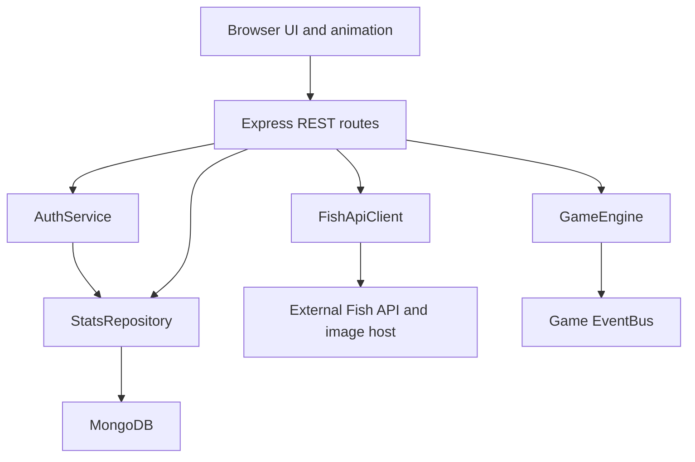

# Architecture and coursework themes

## Components and boundaries

The browser renders SVG scenes and forms. It consumes this project's JSON REST service. Express handles authentication, validation, request serialization and orchestration. GameEngine owns decisions. FishApiClient adapts an external HTTP/JSON service into private puzzle objects. StatsRepository handles storage behind a small interface.

## Low coupling and high cohesion

`GameEngine` imports difficulty settings, events and cryptographic ID creation. It has no dependency on Express, MongoDB, browser markup or the Fish API response format. The clock can be injected for deterministic tests. `FishApiClient` alone interprets `question`, `fish` and `chest`. `StatsRepository` alone implements database queries. `AuthService` alone handles credentials and session creation. The server composes them with dependency injection, demonstrated by HTTP tests substituting a memory repository and puzzle provider.

The application intentionally uses direct calls to the engine for command handling and events for notifications. Events do not mutate independent copies of score or lives; the engine changes those atomically. This is a deliberate refinement of the proposal's event description: splitting authoritative score and time changes across separate event listeners could create inconsistent game state. Browser events drive independently registered feedback listeners. A single-file alternative would be easier initially but harder to test and change.

## Event-driven programming

- DOM events: submit, click and image load/error.
- Asynchronous fetch events: external response, timeout and validation failure.
- Timer callbacks: display ticks, authoritative state polling and housekeeping.
- Custom events: `answer:correct`, `answer:wrong`, `life:lost`, `hint:used`, `checkpoint:reached`, `time:low`, `puzzle:received`, `puzzle:ready`, `level:end`.

Server EventBus extends Node EventEmitter. Browser EventBus extends EventTarget. Each browser response is one authoritative snapshot. Progress animates through SVG group transforms and CSS transitions. Reduced-motion preferences disable animation.

## Interoperability

The service calls the external Fish API over HTTPS, validates its JSON, checks the image origin, downloads the image and retains both answers privately. The browser receives a puzzle identifier and requests a protected internal image route. This avoids browser CORS restrictions and prevents a puzzle filename containing a count from being used as an easy answer leak.

The adapter makes at most two attempts. Invalid schema, timeout, untrusted hosts, image errors or oversized payloads produce a local SVG puzzle with server-known counts. The UI identifies the source as LIVE API or OFFLINE PUZZLE; fallback is never represented as proof of external connectivity.

Prefetching could reduce waiting but adds stale-puzzle lifecycle complexity. The present implementation fetches the next puzzle after an accepted answer. Rules pause until readiness, with a 45-second cap on loading.

## Virtual identity

Registration stores a normalized unique username and a bcrypt hash with an independent salt. Login issues a cryptographically random token; only a SHA-256 digest of the token is stored. The raw token is in an HttpOnly cookie. A distinct session CSRF token is returned to the UI and required on authenticated mutations. Sessions expire after 24 hours. MongoDB TTL cleanup complements the explicit expiration check.

Five incorrect credentials for a username impose a five-minute in-process lockout. Authentication endpoints also apply an IP request limit. Usernames are rendered with textContent on the leaderboard. HTML injection is not permitted by the username pattern, and UI rendering does not trust stored strings as markup.

Cookie authentication supports server-side revocation at logout. JWTs could reduce session reads but complicate revocation. OAuth would delegate identity to a provider but require provider setup; two-factor authentication would reduce stolen-password risk while increasing complexity. These alternatives are discussion topics, not implemented features.

## State and timing

Loading → Playing → Loading repeats until Won or Lost. The server stores a deadline when playing begins. The display clock is approximate; requests use the server deadline. A final answer arriving at or after expiry loses even when the browser still displays a fraction of a second. Correct answers add 5 seconds to the remaining time before the next pause. An old puzzle ID is rejected, and per-user mutations cannot execute concurrently.

Game records contain a unique game ID; score upserts are idempotent. Winning scores are 130, 110 or 90 on Easy; 150, 130 or 110 on Medium; and 200, 180 or 160 on Hard. Losing scores keep earned points without a victory bonus.

## MongoDB records

- users: id, unique username, passwordHash, created.
- sessions: token hash, csrf, userId, username, expires (TTL index).
- scores: unique gameId, userId, username, level, score, rating, won, created.

Active puzzle answers and game state are deliberately held in server memory in this single-instance implementation. Restarting the server ends those rounds. Shared persistence would be needed for restart recovery and multiple server replicas.
